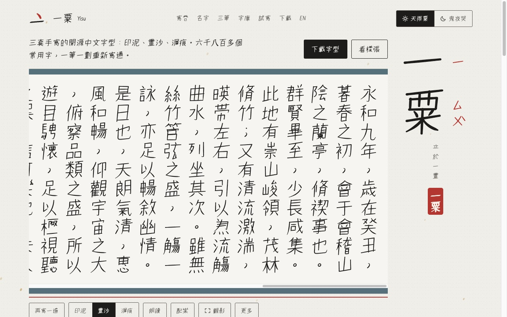

<p align="center">
  <a href="https://yisu.aixie.de">
    <picture>
      <source media="(prefers-color-scheme: dark)" srcset="docs/logo-dark.svg">
      
    </picture>
  </a>
</p>

<p align="center">
  The website of 一粟 (Yisu), three hand-drawn open-source fonts for Chinese and Latin.<br>
  一粟字型的網站：一卷古文，一筆一筆寫出來，邊寫邊讀。
</p>

<p align="center">
  <a href="https://yisu.aixie.de"></a>
  <a href="https://github.com/zjlgdx/yisu-fonts"></a>
  <a href="https://developers.cloudflare.com/workers/static-assets/"></a>
  <a href="LICENSE"></a>
  <a href="OFL.txt"></a>
</p>

<p align="center">
  <a href="https://yisu.aixie.de"><b>Open the site</b></a> ·
  <a href="https://github.com/zjlgdx/yisu-fonts/releases/latest">Download the fonts</a> ·
  <a href="README.zh-Hant.md">中文說明</a> ·
  <a href="#working-on-it">Working on it</a>
</p>

<picture>
  <source media="(prefers-color-scheme: dark)" srcset="docs/site-dark.jpg">
  
</picture>

## What it does

The page writes a classical text a stroke at a time, in vertical columns from right to left. By day it writes 王羲之's 《蘭亭集序》, under the theme 天雨粟. By night it writes the opening of 蘇軾's 《前赤壁賦》, under the theme 鬼夜哭. A reader can also pick 王勃's 《滕王閣序》, whole, with the poem that ends it.

- **The scroll is the fonts writing.** It is drawn on a canvas from the fonts' own centre lines, with each font's own pen: 印泥 (Yinni), 畫沙 (Huasha) and 漏痕 (Louhen). Nothing on the page is a picture of type. Everything else is set in the fonts themselves.
- **朗讀 (read aloud).** A recorded voice reads each sentence while it is written, and the writing keeps time with the voice: a sentence starts when its clip is heard, and its pace follows the clip's length.
- **觀影 (watch).** The scroll alone on a dark screen, large, with the reading and the music:
  - First a title.
  - Then the text, six characters to a column (eight on an upright screen). The camera follows the pen, and the clause being written shows as a caption.
  - Then the whole scroll, end to end. If it is too long to take in at once, it is pulled back only as far as it still reads as writing, and the camera travels along it to where it began.
- **字庫 (the library).** Any of the fonts' characters, written large in stroke order, with the three families side by side.
- **試寫 (try it).** A box to type in, set in any family and weight, across or down. The whole fonts arrive in slices of 300 characters as they are needed.
- **The music.** A 古琴-like plucked string, joined at night by a 簫, worked out note by note in [`tools/music.py`](tools/music.py). Nothing in it is recorded or sampled. It loops to the sample and steps back while the voice speaks.

## The name

一粟, one grain of millet, comes from 前赤壁賦: 「寄蜉蝣於天地，渺滄海之一粟」. The two themes take their names from the 淮南子's story of the day writing was invented: 「倉頡作書，而天雨粟，鬼夜哭」. The tagline 立於一畫 is 石濤's.

## What is here

| Path | What it is |
| --- | --- |
| [`public/index.html`](public/index.html) | The whole page: styles, markup and the script that writes. |
| `public/strokes.js` | Stroke data for the characters the page itself shows. Generated. |
| `public/strokes-all.js` | Stroke data for every other character, fetched when a reader asks for one. Generated. |
| `public/fonts/*.woff2`, `faces.css` | The three families in both weights, cut down to what the page shows in each. Generated. |
| `public/fonts/full/` | Every font whole, in slices of 300 characters. Generated, about 45 MB, not committed. |
| `public/audio/vo/`, `vo.json` | The narration, one clip per sentence, and each clip's length. Generated. |
| `public/audio/day.mp3`, `night.mp3` | The music for each theme. Generated. |
| `public/og.png`, `favicon.*`, `apple-touch-icon.png` | The share image and the mark (滄海一粟: one stroke with a grain above it). Generated. |
| `public/404.html` | The page for an address that isn't there. |
| `public/_headers` | Cache rules: fonts and sound for a day; the files the page starts from are asked for again on each visit. |
| [`tools/`](tools) | The scripts that make the generated files, and the check on the narration. |
| [`wrangler.jsonc`](wrangler.jsonc) | The Cloudflare Workers configuration: static assets, no script of its own. |

## Working on it

### Looking at it

```
python3 -m http.server --directory public
```

### Regenerating the data

Most generated files come from a checkout of [the fonts](https://github.com/zjlgdx/yisu-fonts), with its Python environment set up and the fonts built in `out/`. Run these again after each release of the fonts, and after the page's text changes:

```
FONTS=../yisu-fonts
$FONTS/.venv/bin/python tools/strokes.py $FONTS
$FONTS/.venv/bin/python tools/webfonts.py $FONTS full
$FONTS/.venv/bin/python tools/mark.py $FONTS
$FONTS/.venv/bin/python tools/og.py $FONTS
```

In `index.html`, `class="spec"` marks text set in all three families, and `class="far"` marks the long texts under 讀全文. `tools/webfonts.py` cuts each font to what the page shows. It names each file with a mark of its contents, in `faces.css` and in the page's preload alike, so a returning reader gets the new cut.

### The sound

```
MINIMAX_API_KEY=... python3 -I tools/audio.py
python3 -I tools/hear.py Unihan_Readings.txt
$FONTS/.venv/bin/python tools/music.py
```

- **`tools/audio.py`** asks MiniMax's speech synthesis for one clip per sentence, keeps each answer in `.audio-cache/`, and writes the clips' lengths to `vo.json`. Run it again whenever a text changes: the page paces its writing by those lengths, and puts each clip's length in its address, so a new take is never served from an old cache.
- **`tools/hear.py`** checks the reading without anyone listening:
  - `whisper-cli` writes down what each clip says.
  - That is set against the text, sound by sound, using Unihan's Mandarin readings (tones aside).
  - A clip it marks LISTEN gets another take (`TAKES`), a reading pinned for it (`PINS`), or a person's ear.
  - It needs `ffmpeg`, `whisper-cli` and a large-v3 model in `~/.local/share/whisper/`.
- **`tools/music.py`** needs only numpy and ffmpeg.

### Adding a text

1. Give it a `<p id="text-NAME" class="far">` under 讀全文, an entry in `PIECES` and a button in the page.
2. Add its name to `PIECES` in `tools/audio.py` and to the list in `tools/hear.py`.
3. Run everything above again.

### Deploying

The site is static files served by a Cloudflare Worker at [yisu.aixie.de](https://yisu.aixie.de):

```
npx wrangler deploy
```

`public/fonts/full/` is not in the repository, so make it first (`tools/webfonts.py FONTS full`). Without it, the box to type in falls back to the reader's own fonts for characters the page doesn't already show.

## History

The fonts were called Pinboard (Typewriter, Ballpoint and Marker) up to 0.730. They are 一粟 now, and their families Yinni, Huasha and Louhen.

## Licence

The stroke data and the font files come from the fonts and are under the [SIL Open Font License 1.1](OFL.txt). The page and the tools are under the [MIT License](LICENSE). The narration is synthesised by MiniMax; the music is made by `tools/music.py`.
