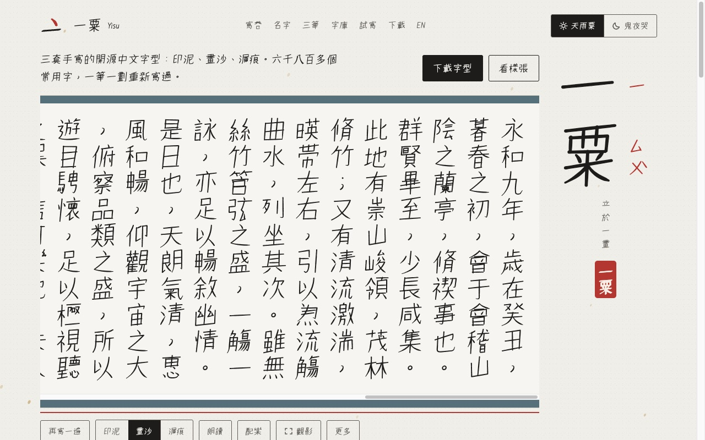

  <a href="https://yisu.aixie.de">
    <picture>
      <source media="(prefers-color-scheme: dark)" srcset="docs/logo-dark.svg">
      
    </picture>
  </a>

  一粟字型的網站：一卷古文，一筆一筆寫出來，邊寫邊讀。 
  <a href="https://yisu.aixie.de"><b>打開網站</b></a> ·
  <a href="https://github.com/zjlgdx/yisu-fonts/releases/latest">下載字型</a> ·
  <a href="README.md">English</a>

<picture>
  <source media="(prefers-color-scheme: dark)" srcset="docs/site-dark.jpg">
  
</picture>

## 網站做什麼

一卷古文，從右到左直排，一筆一筆寫出來：白天（天雨粟）寫王羲之《蘭亭集序》，夜裡（鬼夜哭）寫蘇軾《前赤壁賦》開頭，也可以選王勃《滕王閣序》全文，連同篇末的詩。

- **卷是字型自己寫的。** 用字型本身的筆畫中線和三支筆（印泥、畫沙、漏痕）畫在 canvas 上，頁面上沒有一張字的圖片，其餘文字也都用這三套字排。
- **朗讀。** 錄好的聲音一句一句讀，寫字跟著聲音走：聽到一句的聲音才開始寫這一句，速度隨音檔長短。
- **觀影。** 全螢幕、暗場、大字，有朗讀和配樂：先寫題目，再一欄六字（直立螢幕八字）跟著筆走，下方字幕是正在寫的那一句，最後整卷從頭看到尾。
- **字庫。** 任何一個字放大看筆順，三套字並列。
- **試寫。** 自己打字，換字型、粗細、橫排直排；整套字型按需要三百字一片載入。
- **配樂。** 白天是古琴般的撥弦，夜裡加一管簫，都由 `tools/music.py` 逐音算出來，沒有錄音或取樣；循環無縫，朗讀時自動退後。

## 名字

一粟出自〈前赤壁賦〉「寄蜉蝣於天地，渺滄海之一粟」。兩個主題取自《淮南子》記倉頡造字：「倉頡作書，而天雨粟，鬼夜哭」。題字「立於一畫」出自石濤。

## 開發

- 本地預覽：`python3 -m http.server --directory public`
- 字型每次發佈後，用字型倉庫（`out/` 已建好）重跑 `tools/strokes.py`、`tools/webfonts.py FONTS full`、`tools/mark.py`、`tools/og.py`。
- 朗讀用 MiniMax 語音合成（`tools/audio.py`），再用 `tools/hear.py` 以 whisper 轉寫逐音比對檢查讀音。
- 部署：`npx wrangler deploy`（Cloudflare Workers 靜態資源）。

細節見 [README.md](README.md)。

## 授權

筆畫資料和字型檔來自字型本身，採 [SIL Open Font License 1.1](OFL.txt)；網頁和工具採 [MIT](LICENSE)。
